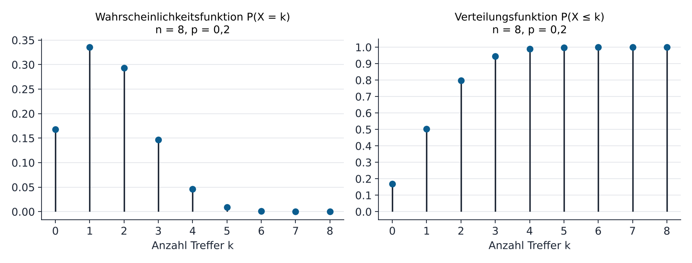
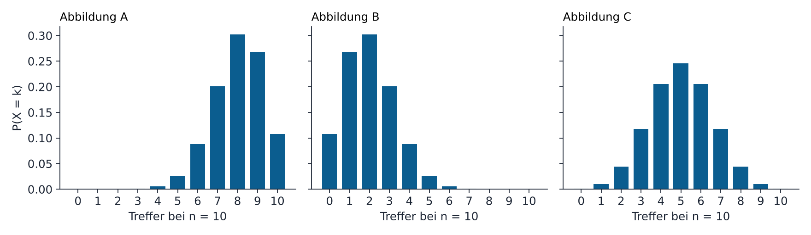
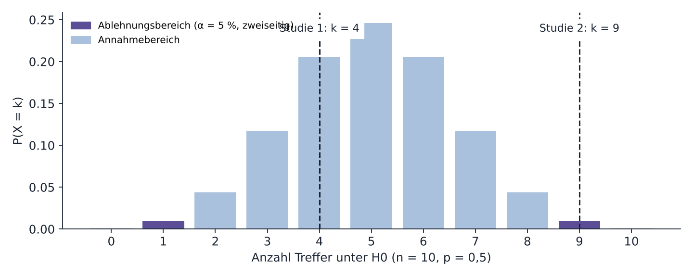
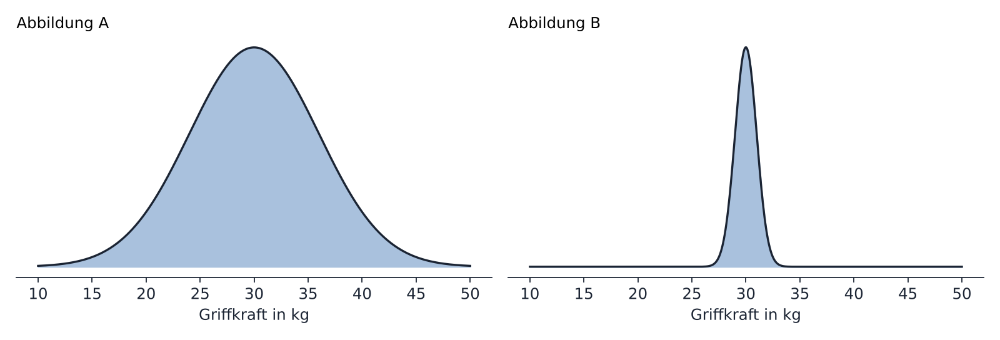
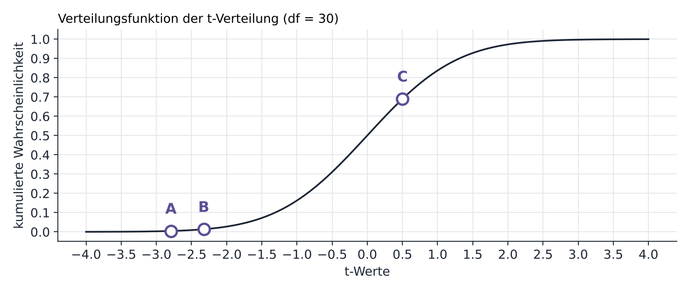
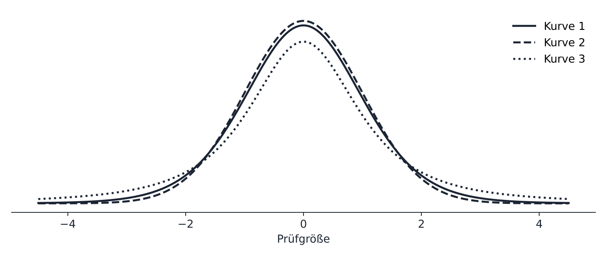
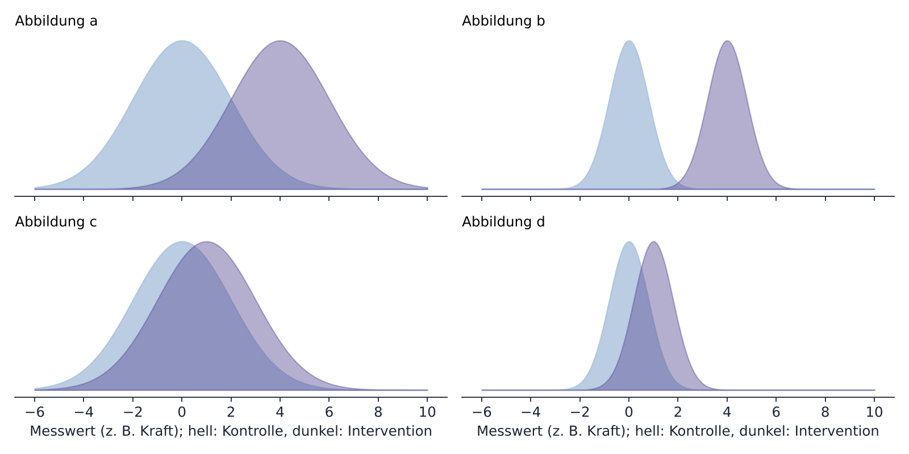

# Probefragen Forschungsmethodik 1: Inferenzstatistik

Öffentliche Übungsfragen im Format der Klausur (Single Choice). Jede Frage hat genau eine richtige Antwort; die Lösung steht aufklappbar darunter.

## Binomialverteilung: Wahrscheinlichkeits- und Verteilungsfunktion

### A01 · Zwei Aussagen bewerten

Die Abbildung zeigt Wahrscheinlichkeits- und Verteilungsfunktion für 8 Versuche mit einer Trefferwahrscheinlichkeit von 20 % (z. B. 8 Patientinnen, Heilungswahrscheinlichkeit 0,2).

| Aussage 1 | Bei 8 Versuchen und einer Trefferwahrscheinlichkeit von 20 % sind 8 Treffer unmöglich. |
| --- | --- |
| Aussage 2 | Bei 8 Versuchen und einer Trefferwahrscheinlichkeit von 20 % ist genau 1 Treffer am wahrscheinlichsten. |

- [ ] **A** Ausschließlich Aussage 1 ist korrekt.
- [ ] **B** Ausschließlich Aussage 2 ist korrekt.
- [ ] **C** Beide Aussagen sind korrekt.
- [ ] **D** Keine Aussage ist korrekt.

Lösung

**B**: Ausschließlich Aussage 2 ist korrekt.

8 Treffer sind sehr unwahrscheinlich (0,2⁸ ≈ 0,000003), aber nicht unmöglich. Der höchste Punkt der Wahrscheinlichkeitsfunktion liegt bei k = 1 (≈ 34 %). In der Fassung von 2022 passte die Abbildung nicht zu p = 0,2.

### A02 · Zwei Aussagen bewerten

Gleiche Abbildung wie oben (n = 8, p = 0,2).

| Aussage 1 | Die Wahrscheinlichkeit, null, einen oder zwei Treffer zu beobachten, beträgt ungefähr 80 %. |
| --- | --- |
| Aussage 2 | Die Wahrscheinlichkeit, mehr als zwei Treffer zu beobachten, beträgt ungefähr 20 %. |

- [ ] **A** Ausschließlich Aussage 1 ist korrekt.
- [ ] **B** Ausschließlich Aussage 2 ist korrekt.
- [ ] **C** Beide Aussagen sind korrekt.
- [ ] **D** Keine Aussage ist korrekt.

Lösung

**C**: Beide Aussagen sind korrekt.

P(X ≤ 2) lässt sich an der Verteilungsfunktion bei k = 2 ablesen: ≈ 0,80. Mehr als zwei Treffer ist das Gegenereignis: 1 − 0,80 ≈ 0,20.

### A05 · Zwei Aussagen bewerten

Beurteilen Sie die Aussagen zur Binomialverteilung.

| Aussage 1 | Eine Binomialverteilung beschreibt die zu erwartenden Trefferzahlen unabhängig von der Trefferwahrscheinlichkeit. |
| --- | --- |
| Aussage 2 | Eine Binomialverteilung beschreibt die zu erwartenden Trefferzahlen bei einer gegebenen Trefferwahrscheinlichkeit. |

- [ ] **A** Ausschließlich Aussage 1 ist korrekt.
- [ ] **B** Ausschließlich Aussage 2 ist korrekt.
- [ ] **C** Beide Aussagen sind korrekt.
- [ ] **D** Keine Aussage ist korrekt.

Lösung

**B**: Ausschließlich Aussage 2 ist korrekt.

Form und Lage der Binomialverteilung hängen von n und p ab; ohne Trefferwahrscheinlichkeit lässt sie sich nicht angeben.

### A07 · Zwei Aussagen bewerten

Beurteilen Sie die Aussagen.

| Aussage 1 | Zehn Münzwürfe, bei denen gezählt wird, wie oft Kopf fällt, sind ein Binomialversuch. |
| --- | --- |
| Aussage 2 | Zwanzig Patientinnen, bei denen nach einer Therapie gezählt wird, wie viele beschwerdefrei sind, sind kein Binomialversuch, weil Menschen verschieden sind. |

- [ ] **A** Ausschließlich Aussage 1 ist korrekt.
- [ ] **B** Ausschließlich Aussage 2 ist korrekt.
- [ ] **C** Beide Aussagen sind korrekt.
- [ ] **D** Keine Aussage ist korrekt.

Lösung

**A**: Ausschließlich Aussage 1 ist korrekt.

Beide Situationen sind Binomialversuche: feste Anzahl unabhängiger Versuche mit zwei Ausgängen. Dass Menschen verschieden sind, ändert daran nichts, solange jede Person die gleiche Wahrscheinlichkeit hat.

### A08 · Zuordnung

Die Abbildungen zeigen drei Binomialverteilungen mit n = 10. Die Trefferwahrscheinlichkeiten sind p = 0,2, p = 0,5 und p = 0,8. Welche Zuordnung stimmt?

- [ ] **A** A: 0,8 · B: 0,2 · C: 0,5
- [ ] **B** A: 0,5 · B: 0,2 · C: 0,8
- [ ] **C** A: 0,2 · B: 0,8 · C: 0,5
- [ ] **D** A: 0,8 · B: 0,5 · C: 0,2

Lösung

**A**: A: 0,8 · B: 0,2 · C: 0,5

Der Gipfel liegt bei n · p Treffern: A um 8, B um 2, C um 5. Bei p = 0,5 ist die Verteilung symmetrisch.

## Binomialtest, Hypothesen und p-Wert

### B01 · Zwei Aussagen bewerten

Beurteilen Sie die Aussagen zum Binomialtest.

| Aussage 1 | Für den Binomialtest werden eine Nullhypothese und eine Alternativhypothese aufgestellt. |
| --- | --- |
| Aussage 2 | Der Binomialtest prüft, ob eine beobachtete Trefferanzahl mit einer erwarteten vereinbar ist. |

- [ ] **A** Ausschließlich Aussage 1 ist korrekt.
- [ ] **B** Ausschließlich Aussage 2 ist korrekt.
- [ ] **C** Beide Aussagen sind korrekt.
- [ ] **D** Keine Aussage ist korrekt.

Lösung

**C**: Beide Aussagen sind korrekt.

Der Binomialtest ist ein Nullhypothesen-Signifikanztest: H0 legt die Trefferwahrscheinlichkeit fest, geprüft wird, ob die Beobachtung dazu passt.

### B02 · Zwei Aussagen bewerten

Beurteilen Sie die Aussagen zum p-Wert im Binomialtest.

| Aussage 1 | Der p-Wert gibt an, wie wahrscheinlich genau die beobachtete Trefferanzahl ist. |
| --- | --- |
| Aussage 2 | Der p-Wert gibt an, wie wahrscheinlich die beobachtete oder eine noch extremere Trefferanzahl ist, wenn die Nullhypothese stimmt. |

- [ ] **A** Ausschließlich Aussage 1 ist korrekt.
- [ ] **B** Ausschließlich Aussage 2 ist korrekt.
- [ ] **C** Beide Aussagen sind korrekt.
- [ ] **D** Keine Aussage ist korrekt.

Lösung

**B**: Ausschließlich Aussage 2 ist korrekt.

Der p-Wert summiert die Wahrscheinlichkeiten des beobachteten und aller extremeren Ergebnisse unter H0. Die Wahrscheinlichkeit für genau einen Wert ist nur ein Teil davon.

### B03 · Zuordnung

Zwei Studien prüfen mit je 10 Patienten, ob ein Test besser oder schlechter als Raten ist (H0: p = 0,5, zweiseitig, α = 5 %). Die Abbildung zeigt die Verteilung unter H0 mit dem vorab festgelegten Ablehnungsbereich. Studie 1 beobachtet 4 Treffer, Studie 2 beobachtet 9 Treffer. Welche Zuordnung stimmt?

- [ ] **A** Studie 1: H0 beibehalten · Studie 2: H0 beibehalten
- [ ] **B** Studie 1: H0 beibehalten · Studie 2: H0 verwerfen
- [ ] **C** Studie 1: H0 verwerfen · Studie 2: H0 beibehalten
- [ ] **D** Studie 1: H0 verwerfen · Studie 2: H0 verwerfen

Lösung

**B**: Studie 1: H0 beibehalten · Studie 2: H0 verwerfen

Der Ablehnungsbereich umfasst 0, 1, 9 und 10 Treffer. 4 Treffer liegen im Annahmebereich und sind mit Raten vereinbar; 9 Treffer liegen im Ablehnungsbereich.

### B08 · Single Choice

In einem RCT wird Schmerz nach Manueller Therapie (MT) mit Schmerz nach Krankengymnastik (KG) bei Patellofemoralem Schmerzsyndrom verglichen. Ausgewertet wird mit einem t-Test, **ungerichtet**. Welches Hypothesenpaar passt?

- [ ] **A** H0: μ_MT ≠ μ_KG · H1: μ_MT = μ_KG
- [ ] **B** H0: μ_MT = μ_KG · H1: μ_MT ≠ μ_KG
- [ ] **C** H0: μ_MT < μ_KG · H1: μ_MT ≥ μ_KG
- [ ] **D** H0: x̄_MT = x̄_KG · H1: x̄_MT ≠ x̄_KG

Lösung

**B**: H0: μ_MT = μ_KG · H1: μ_MT ≠ μ_KG

Ungerichtet heißt: Unterschied in beliebiger Richtung. Hypothesen beziehen sich auf die Populationsmittelwerte μ, nicht auf die Stichprobenmittelwerte x̄.

### B10 · Zwei Aussagen bewerten

Beurteilen Sie die Aussagen.

| Aussage 1 | Der Binomialtest ist ein Nullhypothesen-Signifikanztest. |
| --- | --- |
| Aussage 2 | Der Binomialtest eignet sich, um Messwerte wie die Griffkraft in Kilogramm zu vergleichen. |

- [ ] **A** Ausschließlich Aussage 1 ist korrekt.
- [ ] **B** Ausschließlich Aussage 2 ist korrekt.
- [ ] **C** Beide Aussagen sind korrekt.
- [ ] **D** Keine Aussage ist korrekt.

Lösung

**A**: Ausschließlich Aussage 1 ist korrekt.

Der Binomialtest prüft Zählungen mit zwei Ausgängen (Treffer ja/nein). Für Messwerte wie Kraft ist der t-Test gedacht.

## Standardabweichung, Standardfehler und Messgenauigkeit

### C01 · Single Choice

Im Laufe einer Studie kommen immer mehr Messungen der Griffkraft hinzu, der Stichprobenumfang n steigt. Was ist zu erwarten?

- [ ] **A** Der Standardfehler wird tendenziell kleiner, das Konfidenzintervall enger.
- [ ] **B** Der Standardfehler wird tendenziell größer, das Konfidenzintervall breiter.
- [ ] **C** Der Standardfehler bleibt gleich, nur die Standardabweichung wird kleiner.
- [ ] **D** Der Standardfehler wird tendenziell größer, das Konfidenzintervall enger.

Lösung

**A**: Der Standardfehler wird tendenziell kleiner, das Konfidenzintervall enger.

SE = SD ÷ √n. Mit wachsendem n sinkt der Standardfehler, das Konfidenzintervall wird schmaler.

### C05 · Zuordnung

Welche Maßnahmen verkleinern den Standardfehler des Mittelwerts? (1) mehr Personen einschließen (2) genaueres Messinstrument (3) α von 5 % auf 1 % senken

- [ ] **A** 1 ja · 2 ja · 3 ja
- [ ] **B** 1 nein · 2 ja · 3 nein
- [ ] **C** 1 ja · 2 nein · 3 ja
- [ ] **D** 1 ja · 2 ja · 3 nein

Lösung

**D**: 1 ja · 2 ja · 3 nein

Der Standardfehler hängt nur von SD und n ab. α beeinflusst den kritischen Wert, nicht den Standardfehler.

### C06 · Abbildung

Eine Abbildung zeigt die Griffkraft einzelner Personen. Die andere zeigt die Mittelwerte vieler Stichproben mit je 36 Personen aus derselben Population. Welche Aussage stimmt?

- [ ] **A** A zeigt die Stichprobenmittelwerte, B die Einzelwerte. Die Breite von A beschreibt den Standardfehler.
- [ ] **B** Beide Abbildungen zeigen die Standardabweichung, B stammt nur aus einer kleineren Stichprobe.
- [ ] **C** B zeigt Einzelwerte, die mit einem genaueren Messgerät erhoben wurden.
- [ ] **D** A zeigt die Einzelwerte, B die Stichprobenmittelwerte. Die Breite von B beschreibt den Standardfehler.

Lösung

**D**: A zeigt die Einzelwerte, B die Stichprobenmittelwerte. Die Breite von B beschreibt den Standardfehler.

Mittelwerte streuen weniger als Einzelwerte. Die Streuung der Mittelwerte ist der Standardfehler SD/√n, hier 6/√36 = 1.

## Konfidenzintervall

### D01 · Zwei Aussagen bewerten

Beurteilen Sie die Aussagen zum 95-%-Konfidenzintervall.

| Aussage 1 | Würde man die Studie sehr oft wiederholen, enthielten etwa 95 % der so berechneten Intervalle den wahren Mittelwert. |
| --- | --- |
| Aussage 2 | Das berechnete Intervall 115 bis 123 mmHg enthält den wahren Mittelwert mit 95 % Wahrscheinlichkeit. |

- [ ] **A** Ausschließlich Aussage 1 ist korrekt.
- [ ] **B** Ausschließlich Aussage 2 ist korrekt.
- [ ] **C** Beide Aussagen sind korrekt.
- [ ] **D** Keine Aussage ist korrekt.

Lösung

**A**: Ausschließlich Aussage 1 ist korrekt.

Die 95 % beschreiben das Verfahren. Ein bereits berechnetes Intervall enthält den wahren Wert oder nicht; eine Wahrscheinlichkeit für den Parameter gibt das Konfidenzintervall nicht an.

### D02 · Single Choice

Bei 91 U23-Fußballspielern liegt der systolische Blutdruck im Mittel bei 119 mmHg, das 95-%-Konfidenzintervall reicht von 115,3 bis 122,7 mmHg. Als Normwert gelten 120 mmHg. Was folgt?

- [ ] **A** 95 % der Spieler haben einen Blutdruck zwischen 115,3 und 122,7 mmHg.
- [ ] **B** Der Normwert liegt im Intervall; die Daten sind mit einem mittleren Blutdruck von 120 mmHg vereinbar.
- [ ] **C** Der Blutdruck der Spieler ist niedriger als normal, weil 119 kleiner als 120 ist.
- [ ] **D** Der Blutdruck ist auffällig, weil das Intervall nicht symmetrisch um 120 liegt.

Lösung

**B**: Der Normwert liegt im Intervall; die Daten sind mit einem mittleren Blutdruck von 120 mmHg vereinbar.

Das Konfidenzintervall beschreibt den Mittelwert, nicht die einzelnen Spieler. Liegt der Normwert im Intervall, ist ein wahrer Mittelwert von 120 mmHg mit den Daten vereinbar.

## t-Test und kritischer Wert

### E01 · Zuordnung

Ordnen Sie zu. (1) Das Lungenvolumen von Asthmapatienten wird zu Beginn und nach drei Wochen Atemgymnastik gemessen. (2) Probanden werden in eine exzentrische und eine konzentrische Trainingsgruppe eingeteilt, verglichen wird die Maximalkraft. (3) Die Schulterabduktion nach TEP wird mit dem Richtwert 60° verglichen.

- [ ] **A** 1 Einstichprobe · 2 unabhängig · 3 abhängig
- [ ] **B** 1 abhängig · 2 unabhängig · 3 Einstichprobe
- [ ] **C** 1 abhängig · 2 Einstichprobe · 3 unabhängig
- [ ] **D** 1 unabhängig · 2 abhängig · 3 Einstichprobe

Lösung

**B**: 1 abhängig · 2 unabhängig · 3 Einstichprobe

Dieselben Personen zweimal: abhängig (gepaart). Zwei getrennte Gruppen: unabhängig. Eine Stichprobe gegen einen festen Wert: Einstichproben-t-Test.

### E02 · Zwei Aussagen bewerten

Beurteilen Sie die Aussagen.

| Aussage 1 | t-Tests prüfen, ob ein beobachteter Mittelwertunterschied systematisch ist oder durch Zufall erklärt werden kann. |
| --- | --- |
| Aussage 2 | t-Tests können für nominalskalierte Variablen eingesetzt werden. |

- [ ] **A** Ausschließlich Aussage 1 ist korrekt.
- [ ] **B** Ausschließlich Aussage 2 ist korrekt.
- [ ] **C** Beide Aussagen sind korrekt.
- [ ] **D** Keine Aussage ist korrekt.

Lösung

**A**: Ausschließlich Aussage 1 ist korrekt.

t-Tests vergleichen Mittelwerte und setzen metrische Daten voraus. Nominale Daten wie ja/nein prüft man mit Binomial- oder Chi-Quadrat-Test.

### E03 · Zwei Aussagen bewerten

Beurteilen Sie die Aussagen.

| Aussage 1 | Wenn die Mittelwertdifferenz steigt, wird der p-Wert zwangsläufig kleiner. |
| --- | --- |
| Aussage 2 | Die Effektstärke ist das Verhältnis von Mittelwertdifferenz und Streuung. |

- [ ] **A** Ausschließlich Aussage 1 ist korrekt.
- [ ] **B** Ausschließlich Aussage 2 ist korrekt.
- [ ] **C** Beide Aussagen sind korrekt.
- [ ] **D** Keine Aussage ist korrekt.

Lösung

**B**: Ausschließlich Aussage 2 ist korrekt.

Steigt gleichzeitig die Streuung überproportional, kann t sinken und der p-Wert steigen. Cohen's d ist Mittelwertdifferenz ÷ Standardabweichung.

### E04 · Single Choice

Bei der Berechnung des empirischen t-Werts wird im Allgemeinen ___ am ___ relativiert. Der daraus resultierende p-Wert wird mit dem α-Niveau verglichen. Welche Ergänzung stimmt?

- [ ] **A** die Mittelwertdifferenz · Standardfehler
- [ ] **B** die Standardabweichung · Mittelwert
- [ ] **C** der p-Wert · α-Niveau
- [ ] **D** der Stichprobenumfang · Effektstärke

Lösung

**A**: die Mittelwertdifferenz · Standardfehler

t = Signal ÷ Rauschen = Mittelwertdifferenz ÷ Standardfehler.

### E05 · Zuordnung

Die Abbildung zeigt die Verteilungsfunktion der t-Verteilung (df = 30) mit drei beobachteten t-Werten A, B und C. Ordnen Sie den ungerichteten p-Werten 0,620, 0,027 und 0,009 die Buchstaben zu.

- [ ] **A** 0,620: A · 0,027: B · 0,009: C
- [ ] **B** 0,620: B · 0,027: C · 0,009: A
- [ ] **C** 0,620: C · 0,027: B · 0,009: A
- [ ] **D** 0,620: C · 0,027: A · 0,009: B

Lösung

**C**: 0,620: C · 0,027: B · 0,009: A

Je weiter ein t-Wert von 0 entfernt ist, desto kleiner der p-Wert. C liegt nahe der Mitte (großer p-Wert), A am weitesten außen (kleinster p-Wert).

### E13 · Abbildung

Eine Kurve ist die Standardnormalverteilung, die beiden anderen sind t-Verteilungen mit 2 und mit 10 Freiheitsgraden. Welche Kurve ist die t-Verteilung mit 2 Freiheitsgraden?

- [ ] **A** Das lässt sich nicht erkennen, weil alle Kurven symmetrisch um 0 liegen.
- [ ] **B** Kurve 3
- [ ] **C** Kurve 2
- [ ] **D** Kurve 1

Lösung

**B**: Kurve 3

Wenige Freiheitsgrade bedeuten mehr Unsicherheit: flacherer Gipfel, dickere Ränder. Mit wachsenden Freiheitsgraden nähert sich die t-Verteilung der Normalverteilung (Kurve 2).

## Fehlerarten und Power

### F01 · Zwei Aussagen bewerten

Ein Physiotherapeut möchte für sein RCT eine möglichst hohe Power. Beurteilen Sie die Aussagen.

| Aussage 1 | Um die Power zu steigern, sollte er mehr Probanden untersuchen. |
| --- | --- |
| Aussage 2 | Je höher die Effektstärke, desto kleiner die Power. |

- [ ] **A** Ausschließlich Aussage 1 ist korrekt.
- [ ] **B** Ausschließlich Aussage 2 ist korrekt.
- [ ] **C** Beide Aussagen sind korrekt.
- [ ] **D** Keine Aussage ist korrekt.

Lösung

**A**: Ausschließlich Aussage 1 ist korrekt.

Mehr Personen verkleinern den Standardfehler, die Power steigt. Größere Effekte sind leichter zu entdecken, die Power steigt ebenfalls.

### F06 · Single Choice

Was beschreibt die Power eines Tests?

- [ ] **A** die Wahrscheinlichkeit, H0 zu verwerfen, obwohl sie stimmt
- [ ] **B** die Größe des Effekts in Standardabweichungen
- [ ] **C** die Wahrscheinlichkeit, dass H0 stimmt
- [ ] **D** die Wahrscheinlichkeit, einen tatsächlich vorhandenen Effekt als signifikant zu erkennen

Lösung

**D**: die Wahrscheinlichkeit, einen tatsächlich vorhandenen Effekt als signifikant zu erkennen

Power = 1 − β. Die dritte Option beschreibt α, die vierte Cohen's d.

## Effektgröße und klinische Relevanz

### G01 · Abbildung

Die Abbildungen a bis d zeigen jeweils eine Kontroll- und eine Interventionsgruppe. Welche Abbildung zeigt die größte, welche die kleinste Effektstärke (Cohen's d)? Der erste Buchstabe steht für die größte.

- [ ] **A** a und b
- [ ] **B** b und a
- [ ] **C** d und c
- [ ] **D** c und d
- [ ] **E** b und c
- [ ] **F** a und c

Lösung

**E**: b und c

d = Mittelwertdifferenz ÷ Streuung. Am größten bei großer Differenz und wenig Streuung (b), am kleinsten bei kleiner Differenz und viel Streuung (c).

### G02 · Single Choice

Mit welcher Maßnahme können Forschende die Effektstärke einer Intervention steigern?

- [ ] **A** Keine der genannten Maßnahmen beeinflusst die Effektstärke.
- [ ] **B** das α-Niveau verringern
- [ ] **C** mehr Patienten in die Studie einschließen
- [ ] **D** die Anzahl der Patienten verringern
- [ ] **E** das α-Niveau erhöhen

Lösung

**A**: Keine der genannten Maßnahmen beeinflusst die Effektstärke.

n und α beeinflussen Signifikanz und Power, nicht die Größe des Effekts.

## Beobachtungsstudie und RCT

### H01 · Single Choice

Was ist der entscheidende Vorteil der Randomisierung in einem RCT?

- [ ] **A** Es werden mehr Personen eingeschlossen als in Beobachtungsstudien.
- [ ] **B** Bekannte und unbekannte Störgrößen sind in den Gruppen im Mittel gleich verteilt.
- [ ] **C** Die Teilnehmenden wissen nicht, in welcher Gruppe sie sind.
- [ ] **D** Der p-Wert wird kleiner.

Lösung

**B**: Bekannte und unbekannte Störgrößen sind in den Gruppen im Mittel gleich verteilt.

Weil der Zufall zuteilt, unterscheiden sich die Gruppen im Mittel nur durch die Intervention. Die zweite Option beschreibt Verblindung.

### H05 · Zuordnung

Ordnen Sie die Begriffe den Beschreibungen zu. (1) Intervention (2) Kontrolle (3) Randomisierung. Beschreibungen: (a) Gruppe mit Standardbehandlung, Placebo oder ohne Behandlung als Vergleich (b) Zuteilung zu den Gruppen per Zufall (c) die untersuchte Behandlung, etwa ein Trainingsprogramm

- [ ] **A** 1c · 2b · 3a
- [ ] **B** 1c · 2a · 3b
- [ ] **C** 1b · 2a · 3c
- [ ] **D** 1a · 2c · 3b

Lösung

**B**: 1c · 2a · 3b

Die Intervention ist die untersuchte Behandlung, die Kontrolle der Vergleich, die Randomisierung die zufällige Zuteilung.

